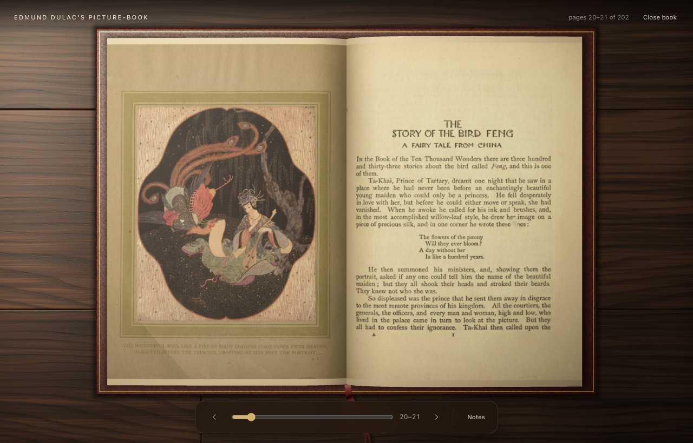
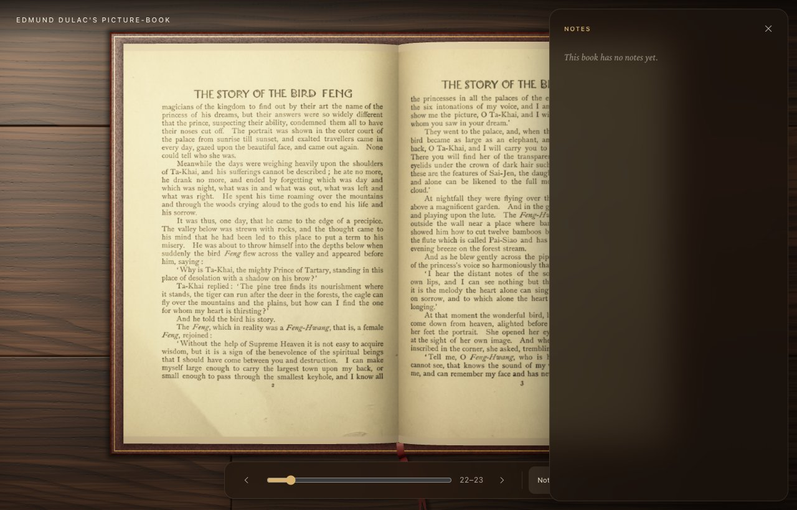
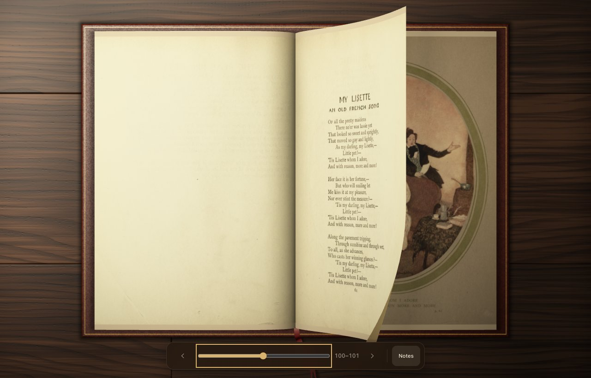

<!-- markdownlint-disable MD033 MD041 -->

  

<h1 align="center">Scriptorium</h1>

Turn folders of scanned pages into books you can page through.

<!-- markdownlint-enable MD033 MD041 -->

Last reviewed: 2026-11-02

Scriptorium turns a folder of scanned pages into a book you can read like the real thing. Pages
curl as you turn them, the scans stay exactly as they were captured, and the app remembers
where you stopped.

It is made for libraries, archives and galleries that want to share old books, and for the
people who read them.

| | |
|---|---|
|  |  |

## Features

- **Make a book from scans.** Choose a folder of JPEG, PNG, WebP, TIFF, JPEG 2000, BMP or GIF pages. Scriptorium
  sorts them in natural order, so `page2` comes before `page10`, and copies them into your
  library.
- **Turn pages naturally.** Drag a corner, click a page, use the arrow keys, or jump with the
  **Go to page** scrubber.
- **Keep your place.** Scriptorium reopens the last book at the page you left.
- **Respect your settings.** With reduced motion turned on, pages fade instead of curling.
- **Keep the originals.** Every page image stays untouched in an open, documented
  [book format](docs/book-format.md).

| | |
|---|---|
|  |  |

## Get started

Scriptorium is in early development. Download the macOS build for Apple silicon (macOS 13.3 or
later) from the [latest release](https://github.com/kgforais1/scriptorium/releases/latest). The
app is not notarized yet, so macOS blocks the first launch. After it does, open **System
Settings → Privacy & Security** and click **Open Anyway**. On Windows, Linux, or an Intel Mac,
build it from source as described in [Developing Scriptorium](docs/development.md). Then:

1. Click **Open…** and choose a folder of scanned pages.
2. Check the title in the dialog and press **Create**.
3. Read. Press **Close book** to return to the home screen.

The [getting-started guide](docs/user/getting-started.md) covers each step, the keyboard
controls, and where your books are stored. The [Dulac tutorial](docs/user/tutorial-dulac.md)
builds a sample book from a public-domain picture book.

## Roadmap

Coming next are OCR text you can search and select, a library view of all your books, and
curator notes that pin stories to places on a page. See the
[product roadmap](plans/2026-08-23-product-roadmap.md) for the full plan, and the
[changelog](CHANGELOG.md) for what each release added.

## Contributing and security

Read [Developing Scriptorium](docs/development.md) to set up a build. Report security problems
privately, as described in [`SECURITY.md`](SECURITY.md).

## Licence

Scriptorium is source-available under the [PolyForm Shield License 1.0.0](LICENSE). Anyone,
companies included, may use, change, and share it for free. Nobody may use it to offer a
product that competes with it, or with any product the licensor or its affiliates provide
using it.

Third-party code keeps its own licences. The bundled C libraries are listed in
[`THIRD_PARTY_NOTICES.md`](THIRD_PARTY_NOTICES.md), and the Rust and npm dependencies in
[`THIRD_PARTY_LICENSES.generated.md`](THIRD_PARTY_LICENSES.generated.md).
